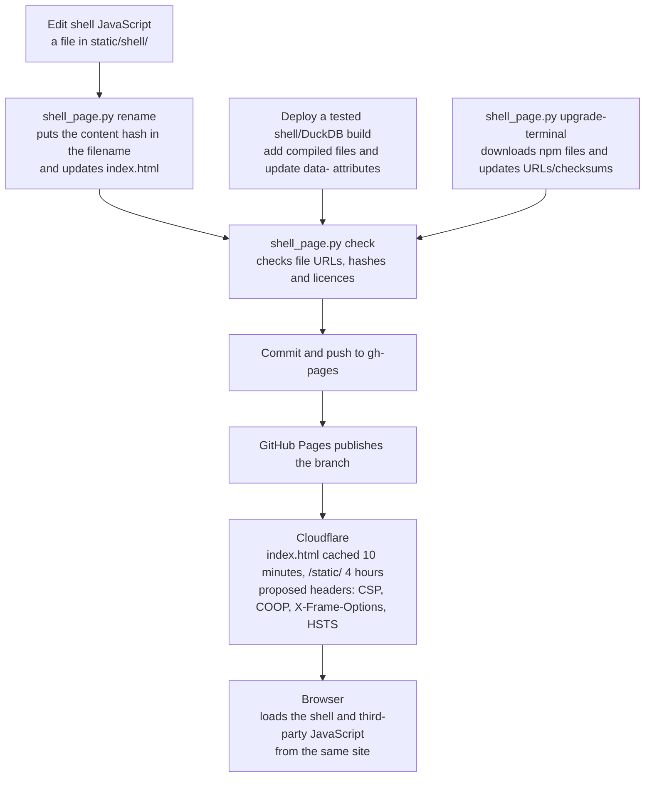

# Web shell page: how its scripts are updated and deployed

GitHub Pages publishes the files on the `gh-pages` branch at shell.duckdb.org. The shell's JavaScript used to be written directly in `index.html`, and the page downloaded xterm from jsDelivr. With this change, `index.html` loads separate JavaScript files from the same site.

Use `scripts/shell_page.py` in this checkout to rename page scripts, upgrade terminal dependencies and check the page before deployment. The proposed security headers must be configured separately at Cloudflare.

```
index.html       HTML, styles and file URLs for the shell
static/shell/    the shell's JavaScript, named <name>.<hash>.js
static/vendor/   third-party files, grouped by package and version
static/assets/   compiled DuckDB engine, worker and shell frontend
scripts/         page maintenance and terminal upgrade tool
.github/workflows/check-shell.yml   CI validation for gh-pages
```

## Before and after

| | Before | After |
|---|---|---|
| Shell JavaScript | About 1400 lines written directly inside four `<script>` elements in `index.html` | Four `.js` files in `static/shell/`, loaded with `<script src="…">` |
| Terminal (xterm, addon-fit) | Downloaded from jsDelivr as version-pinned npm files, with browser Subresource Integrity (SRI) checks | The same npm files hosted under `static/vendor/xterm-5.5.0/` and `static/vendor/addon-fit-0.10.0/`, with each package's `LICENSE` |
| URLs of engine, worker and frontend | The JavaScript object `SHELL_ASSETS`, defined directly in `index.html` | Four `data-` attributes on the `<script>` element that loads `shell-boot` |
| Editing shell JavaScript | Edit `index.html`, then push | Edit the `.js` file, run `shell_page.py rename`, then push |
| Updating engine or worker files | Change their URLs in `SHELL_ASSETS` in `index.html`, then push | Change the corresponding `data-` attributes in `index.html`, then push |
| Check before a push | None | Run `shell_page.py check` |
| JavaScript allowed by CSP | No CSP restriction on code written in HTML or scripts loaded from other sites | Only JavaScript files from the same site, after CSP is configured at Cloudflare |
| Loading the page in another site's iframe | Allowed | Blocked, after the framing restrictions are configured at Cloudflare |

The compiled files stay in `static/assets/`. Their names still include a hash of their contents.

## How an update reaches visitors



The GitHub Pages deployment and cache durations are unchanged. Before committing and pushing the page changes, run these commands from the root of this checkout:

```sh
python3 scripts/shell_page.py rename .   # after editing a file in static/shell/
python3 scripts/shell_page.py check .    # before every push
```

- `rename` calculates SHA-256 from each script's bytes and puts its first 10 hexadecimal characters in the filename. It updates the `<script src>` URL in `index.html`, then runs `check`. The engine files already use this naming convention. Changing the URL prevents browsers from using a script cached for up to 4 hours with a newer `index.html`, which is cached for 10 minutes.
- `check` exits with a non-zero status and reports the problem: an incorrect filename hash, a missing `data-` attribute or a file it refers to, a modified third-party file, a missing `LICENSE`, JavaScript written directly in the HTML, a script loaded from another site, or a callback script URL that incorrectly starts with `./`.
- Do not request a new `/static/` URL on shell.duckdb.org before deployment: Cloudflare can cache the resulting 404 response for 4 hours. After deployment, every local file URL in `index.html` must return HTTP 200:

```sh
for f in $(grep -o -E '\.?/static/[A-Za-z0-9._/-]+\.(js|css|wasm)' index.html | sed 's|^\./|/|' | sort -u); do
    curl -s -o /dev/null -w "%{http_code} $f\n" "https://shell.duckdb.org$f"
done
```

## Updating compiled DuckDB files

Update these files when deploying a tested DuckDB version, an engine or worker fix, or a change to the compiled shell frontend. Editing JavaScript in `static/shell/` does not require a new DuckDB build.

The branch history records builds published by the shell maintainer from the experimental `wire-shell` work. This checkout contains the compiled files, but not a reproducible build procedure for that live shell. The application built on `main` is different; do not replace these files with arbitrary npm bundles.

1. Obtain a compatible build from the shell maintainer. It contains the frontend JavaScript and WebAssembly, the worker JavaScript, and the DuckDB WebAssembly engine.
2. Add the changed files under `static/assets/`, with the first 10 hexadecimal characters of each file's SHA-256 in its filename.
3. Update the corresponding attributes on the `shell-boot` `<script>` element in `index.html`:
   - `data-shell-js`: frontend JavaScript, `duckdb.<hash>.js`.
   - `data-shell-wasm`: frontend WebAssembly, `duckdb.<hash>.wasm`.
   - `data-worker`: worker JavaScript, `worker.<hash>.js`.
   - `data-engine`: DuckDB engine, `duckdb-eh.<hash>.wasm`.
4. Run `python3 scripts/shell_page.py check .`. It checks that the referenced files exist; it does not verify that the compiled files are compatible.
5. Test the build in a browser: run a query, load extensions, import and download a file, and check the console for errors.
6. Commit the new files and `index.html` together, then deploy. Keep previous filenames available during rollout so browsers with cached HTML can still load them. After deployment, run the HTTP 200 check above.

The attributes only select which files the browser loads. `shell_page.py` does not build or download them, and its `rename` command only renames scripts in `static/shell/`.

## Updating xterm and addon-fit

These are terminal dependencies, separate from DuckDB. Upgrade them for a security fix, browser compatibility fix or required feature. A DuckDB release does not automatically require an xterm upgrade.

The current files come from npm packages:

- `@xterm/xterm@5.5.0`: `lib/xterm.js`, `css/xterm.css` and `LICENSE`.
- `@xterm/addon-fit@0.10.0`: `lib/addon-fit.js` and `LICENSE`.

From the root of this checkout, select exact versions and run:

```sh
# Replace these examples with the new versions you have reviewed.
python3 scripts/shell_page.py upgrade-terminal . --xterm 5.5.0 --addon-fit 0.10.0
git diff -- index.html scripts/shell_page.py
git status --short
```

The example versions are already installed, so the command refuses to overwrite their folders. Omit `--xterm` or `--addon-fit` to upgrade only the other package. A checkout path other than `.` can be supplied when running from another directory.

`upgrade-terminal` downloads exact versions from the npm registry, verifies each tarball's SHA-512 against the registry's integrity value, and copies only the required package files and licences. It updates the HTML URLs and expected SHA-256 values in `VENDORED` in `scripts/shell_page.py`, then runs the page check. No package installation or npm lifecycle script runs.

All downloads and package validation finish before any files are written. Invalid versions, existing destination folders, a tarball integrity mismatch or a missing package file stop the upgrade. Previous version folders are preserved. Validation still works if Python assertions are disabled. Filesystem write failures are not rolled back; inspect the working tree before retrying.

Test typing, resizing, colours and terminal links in a browser; the command does not determine whether the selected versions are compatible. Update the version references in this README. Commit the new folders, `index.html`, `scripts/shell_page.py` and documentation together, then deploy. After deployment, run the HTTP 200 check above.

## How these changes address the audit

After `.aws login`, JavaScript running in the page can read its AWS credentials. The file changes remove third-party CDN scripts and allow a CSP that blocks JavaScript written directly in HTML. The remaining protections require response headers at Cloudflare:

- Self-hosted xterm: the browser downloads the terminal files from the shell's own site instead of jsDelivr. Upstream already added browser SRI checks to the CDN files; this change chooses the audit's alternative of DuckDB-controlled hosting and allows `script-src 'self'`. `check` compares the local files with the SHA-256 of the npm package files before deployment; it is not browser SRI.
- Content Security Policy (CSP): the old page would stop working under the proposed `script-src 'self' 'wasm-unsafe-eval'` policy. The new page works with it: the browser allows JavaScript files from the same site and WebAssembly compilation, but blocks JavaScript written directly in HTML, `eval()` and scripts from other sites.
- X-Frame-Options and CSP `frame-ancestors`: block other sites from loading the sign-in page in an iframe and covering it with misleading controls. Sites that want a DuckDB shell include the code on their own pages instead.
- Cross-Origin-Opener-Policy (COOP): `same-origin` prevents a page on another site from keeping access to a shell tab it opened.
- HTTP Strict Transport Security (HSTS): after a browser receives this header over HTTPS, it uses HTTPS for future visits. The HTTP-to-HTTPS redirect also covers visitors who have not received the header yet.

Limitations:

- The headers take effect only when they are set at Cloudflare.
- CI validation is not a deployment gate until the repository administrator requires it before merging. A check after a direct push does not stop GitHub Pages from publishing that push.
- A copy of the shell on another domain gets none of the headers.

## CI validation

`.github/workflows/check-shell.yml` runs `python3 scripts/shell_page.py check .` with Python 3.12 on pull requests targeting `gh-pages` and on pushes to `gh-pages`. The job is named **Validate shell page** and has read-only repository permissions. It validates the checked-out page; it does not rename files, upgrade packages or deploy anything.

- [ ] After merging this workflow, require **Validate shell page** in the branch protection or ruleset for `gh-pages`, and require changes to go through pull requests. The workflow has no path filter, so documentation-only PRs also receive the required check.
- [ ] In a separate PR on `main`, add the page check to `scripts/deploy_benchmarks.sh`, after the benchmark files are copied into its `gh-pages` worktree and before it commits and pushes. It can use `scripts/shell_page.py` from that worktree. Pushes made with `GITHUB_TOKEN` do not normally trigger another workflow, so this branch's push check does not replace that pre-publication check.

This workflow can be introduced by a PR targeting `gh-pages`. Pushing this feature branch alone does not trigger it; the push filter is for `gh-pages`, not the feature branch.

## TODO: configure security headers at Cloudflare

These changes are not applied by this repository. The Cloudflare administrator must configure them after deploying this page change.

Domain: **`shell.duckdb.org` only**, in the Cloudflare zone that manages that hostname (expected: `duckdb.org`). Do not apply these rules to the entire zone, other DuckDB hosts, or customer domains.

### Response Header Transform Rules

In the Cloudflare dashboard, select the zone, then **Rules > Overview > Create rule > Response Header Transform Rule**. Use **Set static**, not **Add static**: additional CSP headers would impose additional restrictions instead of replacing the policy.

Create these rules in the following order. Later rules replace the CSP set by the first rule. Use `Content-Security-Policy` from the start: the browser immediately blocks resources that each policy does not allow.

1. [ ] **Shell: all responses.** Filter:

   ```text
   http.host eq "shell.duckdb.org"
   ```

   Set these header names and values:

   ```http
   Strict-Transport-Security: max-age=86400; includeSubDomains
   Cross-Origin-Opener-Policy: same-origin
   X-Frame-Options: DENY
   X-Content-Type-Options: nosniff
   Referrer-Policy: no-referrer
   Content-Security-Policy: default-src 'none'; script-src 'self' 'wasm-unsafe-eval'; style-src 'self' 'unsafe-inline' https://duckdb.org; img-src 'self' data: https://duckdb.org; font-src https://duckdb.org; connect-src 'self' https://us-east-1.testing.oauth.signin.aws; worker-src 'self'; base-uri 'none'; form-action 'none'; frame-ancestors 'none'
   ```

   This covers `/`, `/index.html`, `/oauth/callback`, `/oauth/callback/` and other paths served with the shell HTML. The testing Sign-In origin above matches `AWS_SIGNIN_CONFIG.endpoint` in the current page. Before a production rollout, replace it with the AWS-approved production origin in both the page configuration and this policy; do not guess that origin or broaden it to all HTTPS hosts.

2. [ ] **Shell: static files and workers.** Filter:

   ```text
   http.host eq "shell.duckdb.org" and starts_with(http.request.uri.path, "/static/")
   ```

   Set only this header; keep the other headers from rule 1:

   ```http
   Content-Security-Policy: default-src 'none'; script-src 'self' 'wasm-unsafe-eval'; connect-src 'self' https:; worker-src 'self'; base-uri 'none'; form-action 'none'; frame-ancestors 'none'
   ```

   This covers `/static/assets/*`, `/static/shell/*` and `/static/vendor/*`. The engine worker needs its own policy: `connect-src https:` allows HTTPS datasets, extensions and AWS API requests. Applying the page's narrower policy to the worker would block those requests.

3. [ ] **Shell: API documentation.** Filter:

   ```text
   http.host eq "shell.duckdb.org" and starts_with(http.request.uri.path, "/docs/")
   ```

   Set only this header; keep the other headers from rule 1:

   ```http
   Content-Security-Policy: default-src 'none'; script-src 'self' 'sha256-10m9WSfFWWa1qM9Z5+4hPCEFJP7DRPogeAkaBk+dSEo='; style-src 'self' 'unsafe-inline'; img-src 'self' data:; font-src 'self'; connect-src 'self'; base-uri 'none'; form-action 'none'; frame-ancestors 'none'
   ```

   This covers `/docs/` and its pages and assets. The SHA-256 permits the inline theme script in the documentation currently on this branch; recalculate it if a documentation update changes that script.

### Other Cloudflare settings and rollout

- [ ] In **Rules > Overview**, create a **Single Redirect** for `http://shell.duckdb.org/*` to `https://shell.duckdb.org/${1}`: status **301**, preserve the query string. Do not enable zone-wide **Always Use HTTPS**, because native DuckDB uses HTTP extension repositories on other hosts.
- [ ] In **Web Analytics > Manage site > Advanced options > Add rule**, exclude hostname `shell.duckdb.org`, all paths, from automatic analytics injection. Otherwise Cloudflare adds a script from `static.cloudflareinsights.com`, which the proposed CSP blocks.
- [ ] Start HSTS with rule 1's `max-age=86400` (one day). Agree an observation period with the Cloudflare administrator. After verifying HTTPS, certificates, redirects and the AWS callback during that period, increase it to `Strict-Transport-Security: max-age=31536000; includeSubDomains` (one year). A fixed one-week delay is not required by HSTS.

  Browsers store HSTS, and each new response refreshes its duration. Changing Cloudflare settings does not immediately clear policies already stored by visitors, so the shorter initial duration limits the impact of an HTTPS configuration problem. Do not add `preload` or enable HSTS for the entire `duckdb.org` zone as part of this task. On `shell.duckdb.org`, `includeSubDomains` covers only names below `shell.duckdb.org`, not other DuckDB hosts.

Check the public responses, not just the Cloudflare dashboard:

```sh
curl -sI http://shell.duckdb.org/  # 301 to HTTPS
for p in / /oauth/callback /static/assets/worker.c9d26c9032.js /docs/; do
    echo "== $p"
    curl -sI "https://shell.duckdb.org$p" | grep -i -E '^(strict-transport-security|cross-origin-opener-policy|x-frame-options|x-content-type-options|referrer-policy|content-security-policy):'
done
```

After applying these settings, all four responses must include the common headers. `/` and `/oauth/callback` must have the page CSP, the worker the static-files CSP, and `/docs/` the documentation CSP. Update the worker URL in this check when deploying a different build.

These rules must not introduce `Cross-Origin-Embedder-Policy` yet. Cross-origin isolation for threaded Wasm is a separate rollout and would require changes to resources loaded from `duckdb.org`.
