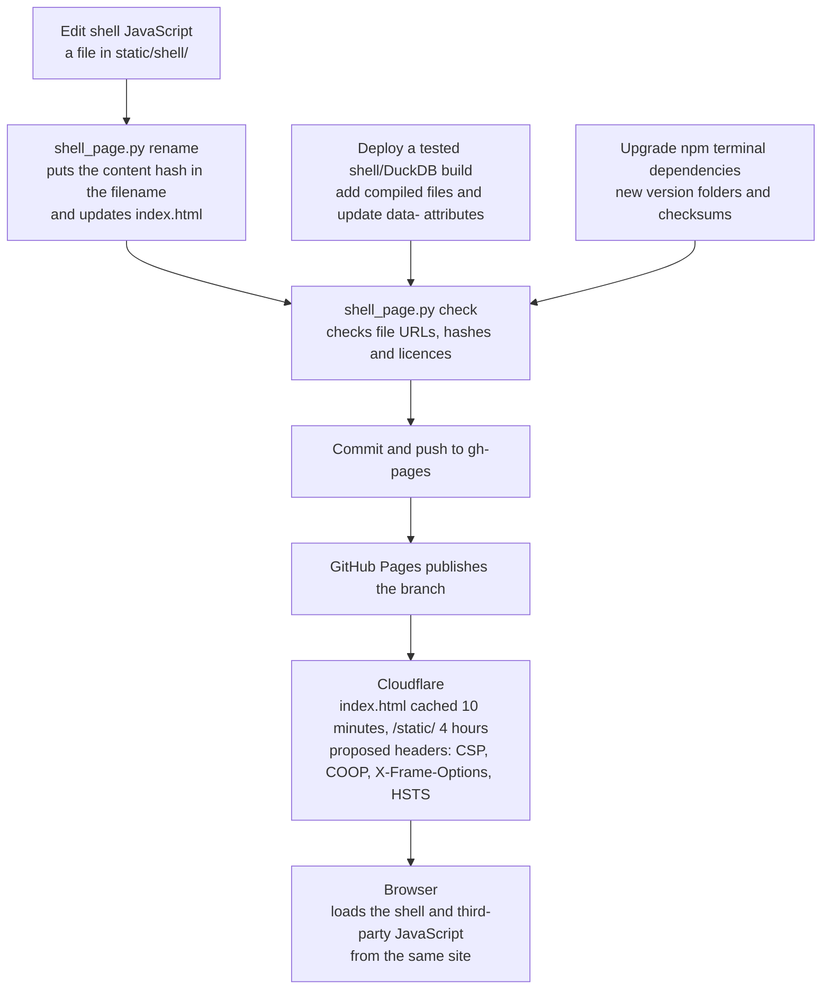

# Web shell page: how its scripts are updated and deployed

GitHub Pages publishes the files on the `gh-pages` branch at shell.duckdb.org. The shell's JavaScript used to be written directly in `index.html`, and the page downloaded xterm from jsDelivr. With this change, `index.html` loads separate JavaScript files from the same site.

Use `scripts/shell_page.py` in this checkout to rename and check the page scripts before deployment. The proposed security headers must be configured separately at Cloudflare.

```
index.html       HTML, styles and file URLs for the shell
static/shell/    the shell's JavaScript, named <name>.<hash>.js
static/vendor/   third-party files, grouped by package and version
static/assets/   compiled DuckDB engine, worker and shell frontend
scripts/         page maintenance tool
```

## Before and after

| | Before | After |
|---|---|---|
| Shell JavaScript | About 1400 lines written directly inside four `<script>` elements in `index.html` | Four `.js` files in `static/shell/`, loaded with `<script src="…">` |
| Terminal (xterm, addon-fit) | Downloaded from jsDelivr as generated `.min` files, without a browser integrity check | Files from the npm packages, stored in `static/vendor/xterm-5.5.0/` and `static/vendor/addon-fit-0.10.0/` with each package's `LICENSE` |
| URLs of engine, worker and frontend | The JavaScript object `SHELL_ASSETS`, defined directly in `index.html` | Four `data-` attributes on the `<script>` element that loads `shell-boot` |
| Editing shell JavaScript | Edit `index.html`, then push | Edit the `.js` file, run `shell_page.py rename`, then push |
| Updating engine or worker files | Change their URLs in `SHELL_ASSETS` in `index.html`, then push | Change the corresponding `data-` attributes in `index.html`, then push |
| Check before a push | None | Run `shell_page.py check` |
| JavaScript allowed by CSP | No CSP restriction on code written in HTML or scripts loaded from other sites | Only JavaScript files from the same site, after CSP is configured at Cloudflare |
| Loading the page in another site's iframe | Allowed | Blocked, after the framing restrictions are configured at Cloudflare |

The compiled files stay in `static/assets/`. Their names still include a hash of their contents.

## How an update reaches visitors



The GitHub Pages deployment and cache durations are unchanged. Before committing and pushing the page changes, run these commands from the root of this checkout:

```sh
python3 scripts/shell_page.py rename .   # after editing a file in static/shell/
python3 scripts/shell_page.py check .    # before every push
```

- `rename` calculates SHA-256 from each script's bytes and puts its first 10 hexadecimal characters in the filename. It updates the `<script src>` URL in `index.html`, then runs `check`. The engine files already use this naming convention. Changing the URL prevents browsers from using a script cached for up to 4 hours with a newer `index.html`, which is cached for 10 minutes.
- `check` exits with a non-zero status and reports the problem: an incorrect filename hash, a missing `data-` attribute or a file it refers to, a modified third-party file, a missing `LICENSE`, JavaScript written directly in the HTML, a script loaded from another site, or a callback script URL that incorrectly starts with `./`.
- Do not request a new `/static/` URL on shell.duckdb.org before deployment: Cloudflare can cache the resulting 404 response for 4 hours. After deployment, every local file URL in `index.html` must return HTTP 200:

```sh
for f in $(grep -o -E '\.?/static/[A-Za-z0-9._/-]+\.(js|css|wasm)' index.html | sed 's|^\./|/|' | sort -u); do
    curl -s -o /dev/null -w "%{http_code} $f\n" "https://shell.duckdb.org$f"
done
```

## Updating compiled DuckDB files

Update these files when deploying a tested DuckDB version, an engine or worker fix, or a change to the compiled shell frontend. Editing JavaScript in `static/shell/` does not require a new DuckDB build.

The branch history records builds published by the shell maintainer from the experimental `wire-shell` work. This checkout contains the compiled files, but not a reproducible build procedure for that live shell. The application built on `main` is different; do not replace these files with arbitrary npm bundles.

1. Obtain a compatible build from the shell maintainer. It contains the frontend JavaScript and WebAssembly, the worker JavaScript, and the DuckDB WebAssembly engine.
2. Add the changed files under `static/assets/`, with the first 10 hexadecimal characters of each file's SHA-256 in its filename.
3. Update the corresponding attributes on the `shell-boot` `<script>` element in `index.html`:
   - `data-shell-js`: frontend JavaScript, `duckdb.<hash>.js`.
   - `data-shell-wasm`: frontend WebAssembly, `duckdb.<hash>.wasm`.
   - `data-worker`: worker JavaScript, `worker.<hash>.js`.
   - `data-engine`: DuckDB engine, `duckdb-eh.<hash>.wasm`.
4. Run `python3 scripts/shell_page.py check .`. It checks that the referenced files exist; it does not verify that the compiled files are compatible.
5. Test the build in a browser: run a query, load extensions, import and download a file, and check the console for errors.
6. Commit the new files and `index.html` together, then deploy. Keep previous filenames available during rollout so browsers with cached HTML can still load them. After deployment, run the HTTP 200 check above.

The attributes only select which files the browser loads. `shell_page.py` does not build or download them, and its `rename` command only renames scripts in `static/shell/`.

## Updating xterm and addon-fit

These are terminal dependencies, separate from DuckDB. Upgrade them for a security fix, browser compatibility fix or required feature. A DuckDB release does not automatically require an xterm upgrade.

The current files come from npm packages:

- `@xterm/xterm@5.5.0`: `lib/xterm.js`, `css/xterm.css` and `LICENSE`.
- `@xterm/addon-fit@0.10.0`: `lib/addon-fit.js` and `LICENSE`.

1. Select compatible package versions and download their npm tarballs. Verify each tarball against the npm registry's integrity value.
2. Copy the package files, without editing them, into new folders under `static/vendor/`: `xterm-<version>/` and `addon-fit-<version>/`. Keep each package's `LICENSE` beside its files.
3. Update the stylesheet and two script URLs in `index.html` to use the new version folders.
4. Update the file paths and expected SHA-256 values in `VENDORED` in `scripts/shell_page.py`. These are full SHA-256 digests encoded as Base64 with a `sha256-` prefix, not the shortened hexadecimal hashes used in script filenames.
5. Run `python3 scripts/shell_page.py check .`, then test typing, resizing, colours and terminal links in a browser.
6. Commit the package files, `index.html` and the updated checksum entries together, then deploy. Keep the previous version folders available during rollout. After deployment, run the HTTP 200 check above.

## How these changes address the audit

After `.aws login`, JavaScript running in the page can read its AWS credentials. The file changes remove third-party CDN scripts and allow a CSP that blocks JavaScript written directly in HTML. The remaining protections require response headers at Cloudflare:

- Self-hosted xterm: the browser downloads the terminal files from the shell's own site instead of jsDelivr. `check` compares them with the SHA-256 of the npm package files. The previous `.min` URLs are generated by jsDelivr and are not suitable for stable Subresource Integrity (SRI) checks.
- Content Security Policy (CSP): the old page would stop working under the proposed `script-src 'self' 'wasm-unsafe-eval'` policy. The new page works with it: the browser allows JavaScript files from the same site and WebAssembly compilation, but blocks JavaScript written directly in HTML, `eval()` and scripts from other sites.
- X-Frame-Options and CSP `frame-ancestors`: block other sites from loading the sign-in page in an iframe and covering it with misleading controls. Sites that want a DuckDB shell include the code on their own pages instead.
- Cross-Origin-Opener-Policy (COOP): `same-origin` prevents a page on another site from keeping access to a shell tab it opened.
- HTTP Strict Transport Security (HSTS): after a browser receives this header over HTTPS, it uses HTTPS for future visits. The HTTP-to-HTTPS redirect also covers visitors who have not received the header yet.

Limitations:

- The headers take effect only when they are set at Cloudflare.
- Nothing runs `check` automatically. It is a manual step until the site is built by a workflow.
- A copy of the shell on another domain gets none of the headers.
